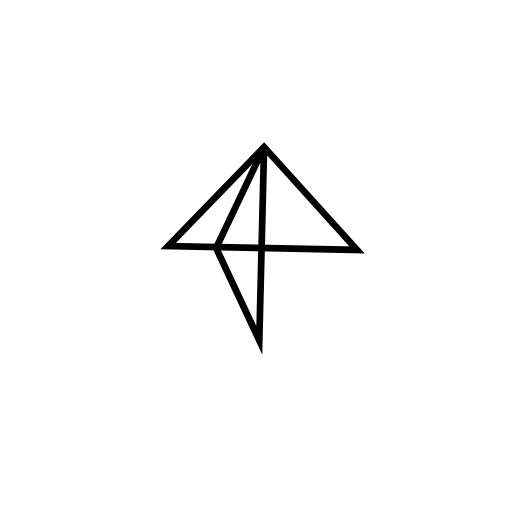

<div align="center">
  
</div>

# Kite

Kite is an open-source crypto payment processor you run yourself. Create payment links, let customers pay with any token on the chains you support, and receive the settlement token with webhooks telling your systems what happened.

This server is the whole product: a Bun + Elysia API, the dashboard for running it, and the public checkout page customers pay on.

## What it does

- **Payment links**: priced in a fiat currency, with optional line items, your own `reference` and `meta`.
- **Checkout**: customers pay by connecting a wallet (gasless with x402 where the token supports it) or by sending tokens to an address, shown as a QR code or text. It can also open over your own site with [`@kite-01/js`](https://github.com/Kite-01/monorepo/tree/main/packages/js).
- **Agent payments**: a payment link is also an [x402](https://www.x402.org) resource. An agent that fetches `/pay/<id>` with GET or POST gets a `402` offering every network that takes x402, signs one and pays by repeating the request.
- **Any token in, your token out**: payments in another token are swapped through Uniswap V3, priced from time-weighted averages so a moved pool can't skew a quote.
- **Settlement on-chain**: each payment runs through its own [Kite contract](https://github.com/Kite-01/contracts), which settles, pays fees or refunds.
- **Webhooks** for every transfer status change, signed so you can verify them.
- **Apps and API keys**: separate merchants or projects, each with scoped keys.
- **Fees**, chains, tokens and price feeds, all managed from the dashboard.
- **OpenAPI** spec and interactive docs at `/openapi`.

## Getting started

You need [Bun](https://bun.sh) 1.4+ and PostgreSQL.

1. **Install**

   ```sh
   bun install
   bun install --cwd client
   ```

2. **Start Postgres**, if you don't have one. This matches `.env.example`:

   ```sh
   docker run -d --name kite-db -p 54320:5432 \
     -e POSTGRES_PASSWORD=postgres -e POSTGRES_DB=kite postgres:17
   ```

3. **Configure**: copy `.env.example` to `.env` and fill it in (see [Configuration](#configuration)). At minimum, set your own `KITE_ENCRYPTION_KEY`, `KITE_OPERATOR_MNEMONIC` and `KITE_ROOT_KEY`.

4. **Migrate and run**

   ```sh
   bun run migrate
   bun run dev
   ```

   The API and dashboard run together on `KITE_PORT` with hot reload.

5. **Set it up in the dashboard**: open `http://localhost:3000`, sign in with your root key, then:
   1. under **Providers**, add the keys for a deposit notifier (QuickNode or Alchemy) and, optionally, a gas sponsor (Alchemy or thirdweb);
   2. under **Chains**, add a chain and configure it with your Kite factory address and settlement token;
   3. create an **App**, turn on the **Chains** it accepts with an address on each, then create an **API key** for your backend;
   4. create a **Payment link** and open it to pay.

To try it without real funds, set `KITE_IS_TESTNET=true` (see [Testnets](#testnets)).

## Taking payments from your app

The usual integration has three parts, and the [Kite packages](https://github.com/Kite-01/monorepo) handle each:

1. Your backend creates a payment link for the order with [`@kite-01/sdk`](https://github.com/Kite-01/monorepo/tree/main/packages/sdk), setting `reference` to your order id.
2. Your site opens it with `openCheckout` from [`@kite-01/js`](https://github.com/Kite-01/monorepo/tree/main/packages/js), or redirects to `/pay/<id>`.
3. Kite sends a `Transfer` webhook when the payment settles. Your backend verifies it and fulfils the order.

### Authentication

Every API request authenticates in one of two ways:

- **API key**: each request is signed with the key's Ed25519 private key. Send `x-kite-api-key-id`, `x-kite-timestamp` (Unix seconds), `x-kite-nonce` (single use) and `x-kite-signature`, a base64url signature of:

  ```text
  timestamp \n nonce \n METHOD \n path?query \n sha256(body) as hex
  ```

  The key's scopes decide what it can do. `@kite-01/sdk` signs for you.

- **Root key**: `x-kite-root-key`, plus `x-kite-app-id` to act as one app. It can do everything, so keep it to administration.

The checkout routes under `/api/checkout` need no credentials: anyone with a payment link can pay it.

### Webhooks

Add a webhook URL to an app in the dashboard and Kite POSTs to it on every transfer, deposit, recovery and excess-refund event:

```json
{
  "id": "delivery id",
  "eventId": "event id, the same across retries",
  "webhookId": "…",
  "category": "Transfer",
  "previous": { "status": "Processing" },
  "current": { "status": "Settled" },
  "data": { "…": "the transfer, with its quote and payment link" }
}
```

Each delivery carries `X-Kite-Timestamp` and `X-Kite-Signature`, the hex HMAC-SHA256 of `t=<timestamp>&<raw body>` keyed with the webhook's signing secret. `verifyWebhook` in `@kite-01/sdk` checks both. Failed deliveries are retried; use `eventId` to ignore repeats.

### Getting paid on one chain

By default a payment settles to the app's address on the chain it was paid on. To receive every payment in one place instead, set a **payout token** and **payout address** on the app, for example USDC on NEAR at `shop.near`:

1. When a transfer opens, Kite asks [NEAR Intents](https://docs.near-intents.org/) (1Click) for a deposit address that converts the chain's settlement token into the payout token. The transfer settles into that address, and Intents delivers the payout token.
2. The transfer timeline and the dashboard show the payout's progress, ending with the delivery transaction or a refund.
3. Where Intents has no route, or can't quote, the payment settles to the app's address on the paying chain. Intents refunds go to that address too, so the operator never holds the money.

Payout tokens are listed at `GET /api/tokens/payouts`. A 1Click API key, set under **Providers**, avoids the extra 0.25% fee charged without one. NEAR Intents has no testnet.

### API reference

The full API is documented at `/openapi`, with the spec at `/openapi/json`. Every operation is named (`paymentLinks.create`, `transfers.get`, …) and says how it authenticates.

## Configuration

All settings come from environment variables, checked at startup:

| Variable                          | Required | Description                                                                      |
| --------------------------------- | -------- | -------------------------------------------------------------------------------- |
| `KITE_PUBLIC_BASE_URL`            | yes      | The public URL of this server, used for provider callbacks and links             |
| `KITE_PG_DB_URL`                  | yes      | Postgres connection URL                                                          |
| `KITE_ENCRYPTION_KEY`             | yes      | 32 random bytes, base64 (`openssl rand -base64 32`); encrypts secrets at rest    |
| `KITE_OPERATOR_MNEMONIC`          | yes      | BIP-39 mnemonic of the operator wallet that settles and refunds transfers        |
| `KITE_ROOT_KEY`                   | yes      | At least 16 characters; signs you into the dashboard and grants full API access  |
| `KITE_PORT`                       |          | Default `3000`                                                                   |
| `KITE_ENABLE_DASHBOARD`           |          | Serve the dashboard. The checkout at `/pay` is served either way. Default `true` |
| `KITE_ENABLE_OPENAPI_UI_SPECS`    |          | Serve `/openapi`. Default `true`                                                 |
| `KITE_ENABLE_OPENAPI_UI_PROVIDER` |          | `scalar` (default) or `swagger`                                                  |
| `KITE_IS_TESTNET`                 |          | Run on testnets instead of mainnets. Default `false`                             |

Provider keys (QuickNode, Alchemy, thirdweb) aren't environment variables: set them from the dashboard's **Providers** page, where they're stored encrypted.

### Testnets

Run a separate server with `KITE_IS_TESTNET=true` and its own database. A server without the flag only offers mainnets, so test tokens can never pay a real payment link. Switching the flag on an existing database hides the other kind of chains rather than deleting them.

## Running in production

```sh
docker build -t kite-server .
docker run -p 3000:3000 --env-file .env kite-server
```

The image builds the dashboard and runs migrations before starting.

## Development

```sh
bun run dev         # API and dashboard with hot reload
bun run test        # tests, against a throwaway Postgres they start themselves
bun run check       # typecheck
bun run lint        # oxlint and Prettier
bun run build       # typecheck and build the dashboard
bun run migrate     # apply migrations
bun run db:generate # generate a migration after changing src/db/schema
bun run db:studio   # browse the database
bun run spec        # print the OpenAPI spec without a database
```

The code lives in `src/`: routes in `api/`, business logic in `services/`, chain and provider integrations in `sdks/`, the schema and migrations in `db/` and `drizzle/`. The dashboard and checkout are a React app in `client/`.

## Troubleshooting

- **The server won't start**: it lists any environment variable that's missing or invalid. `KITE_ENCRYPTION_KEY` must decode to exactly 32 bytes.
- **Can't connect to Postgres**: check `KITE_PG_DB_URL`, then run `bun run migrate`.
- **Deposits aren't detected**: the chain needs a deposit notifier with its keys set under **Providers**, and `KITE_PUBLIC_BASE_URL` must be reachable from the internet so the provider can call back.
- **`Invalid signature`**: sign the exact body you send, and the path with its query string. Clocks must be within five minutes, and each nonce works once.

## Contributing

Contributions are welcome. See [CONTRIBUTING.md](CONTRIBUTING.md) for setup, tests and how changes are reviewed.

To report a vulnerability, follow [SECURITY.md](SECURITY.md) rather than opening an issue.

## License

The Kite server is licensed under the [GNU Affero General Public License v3.0](LICENSE), with additional terms in [NOTICE.md](NOTICE.md):

- Every page that shows a payer a payment keeps the "Powered by Kite" notice, linked to [usekite.site](https://usekite.site).
- Modified versions must be marked as modified, and can't be called Kite.
- If you run a modified version for others over a network, the AGPL requires you to offer them its source.

To run Kite without the notice, or under other terms, ask for a commercial license through [usekite.site](https://usekite.site).
